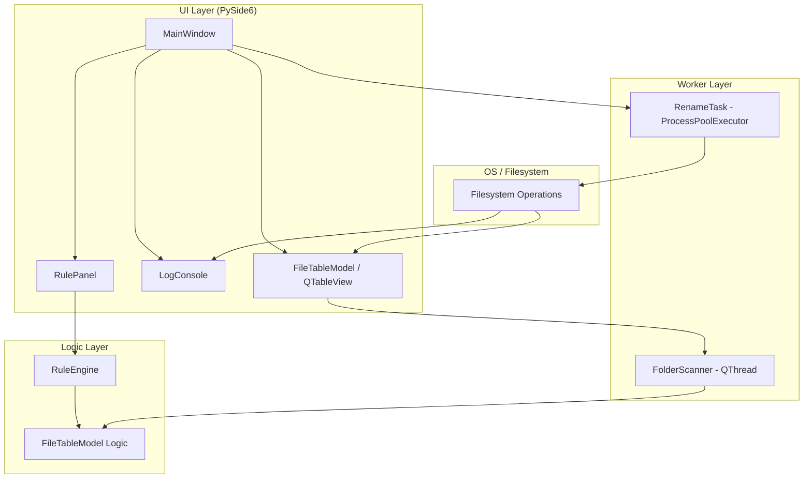

# Architecture Overview

This document describes the architecture and data flow of BatchAlchemy, a PySide6-based bulk file renaming utility.

## System Architecture

BatchAlchemy follows a layered architecture to separate UI concerns, business logic, and heavy processing. Communication between layers is primarily handled through PySide6 Signals and Slots to maintain responsiveness and decoupling.

### Components

- **UI Layer**:
    - `MainWindow`: The central orchestrator. It manages the application lifecycle, theme switching, and coordinates communication between the Logic, Worker, and Widget layers.
    - `RulePanel`: A specialized widget for configuring transformation rules (Regex, Search/Replace, Prefix, Suffix).
    - `LogConsole`: A thread-safe, reactive widget that displays real-time logs from both the main UI and background worker threads.
    - `FileTableModel`: A `QAbstractTableModel` that maintains the state of the file list. It handles sorting, filtering, and proactive collision/permission checks.

- **Logic Layer**:
    - `RuleEngine`: A stateless service that applies a sequence of transformation rules to a list of filenames.
    - `FileTableModel Logic`: Embedded within the model, it manages the "Live Preview" of renames and provides an undo buffer for manual cell edits.

- **Worker Layer**:
    - `FolderScanner`: A `QThread` that performs filesystem crawling (via `os.walk`) to discover files without blocking the UI.
    - `RenameTask`: Manages the parallel execution of file renaming operations using a `ProcessPoolExecutor` to leverage multi-core CPUs.

- **OS / Filesystem**:
    - `Filesystem Operations`: Direct interactions with the operating system via `os` and `pathlib` (e.g., renaming, checking permissions, existence, and directory structures).

---

## Data Flow

### 1. Discovery Flow
1. **Input**: User selects a directory via `QFileDialog` in `MainWindow`.
2. **Action**: `MainWindow` instantiates and starts a `FolderScanner` in a background thread.
3. **Process**: `FolderScanner` crawls the filesystem and builds a list of file dictionaries (source path, original name, etc.).
4. **Output**: The scanner emits the file list via the `finished` signal, which `MainWindow` uses to populate the `FileTableModel`.

### 2. Rule Application Flow
1. **Input**: User configures rules in the `RulePanel`.
2. **Action**: `MainWindow` requests the current rule set from the `RulePanel`.
3. **Process**: `MainWindow` passes the rule set to the `RuleEngine`, which calculates new filenames for all files in the model that haven't been manually edited.
4. **Output**: The `FileTableModel` updates the "New Name" column, triggering a UI refresh.

### 3. Execution Flow
1. **Input**: User clicks "Commit" in `MainWindow`.
2. **Action**: `MainWindow` creates a `RenameTask` and hands it a list of (source, destination) pairs.
3. **Process**: `RenameTask` distributes the work to a `ProcessPoolExecutor`. Each worker performs a final safety check (collision/permission) before executing `os.rename`.
4. **Output**: Progress and results are emitted via signals from the worker threads back to the `LogConsole` and `FileTableModel`.

---

## Technology Stack
- **Language**: Python 3.14+
- **GUI Framework**: PySide6 (Qt for Python)
- **Concurrency**: `QThread` (for I/O-bound tasks), `ProcessPoolExecutor` (for CPU/OS-bound tasks)
- **Dependency Management**: `uv` / `pipx`
